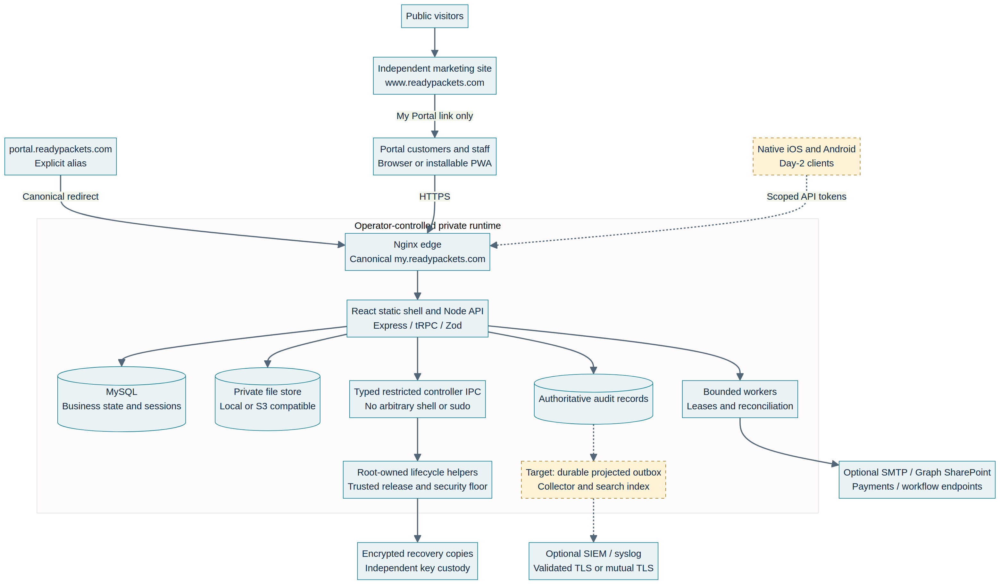
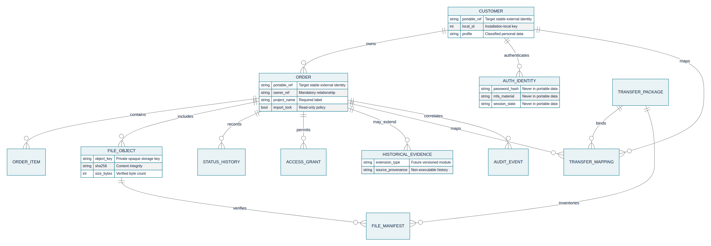
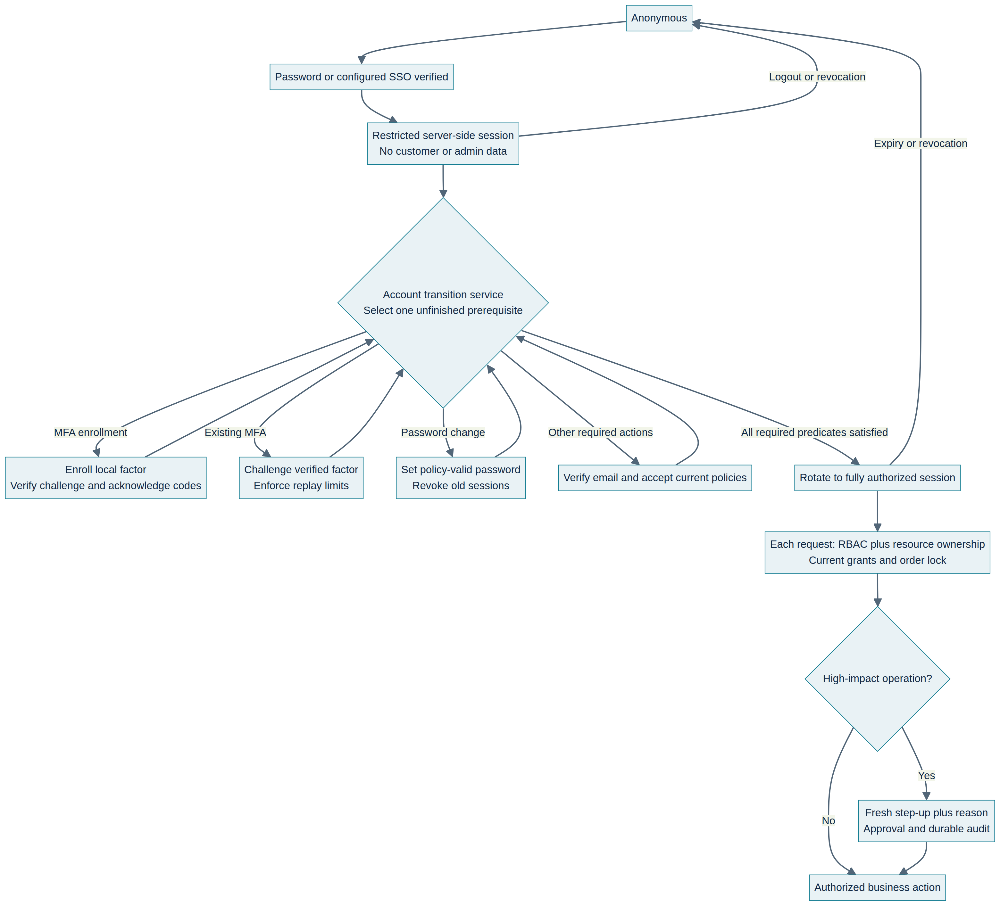
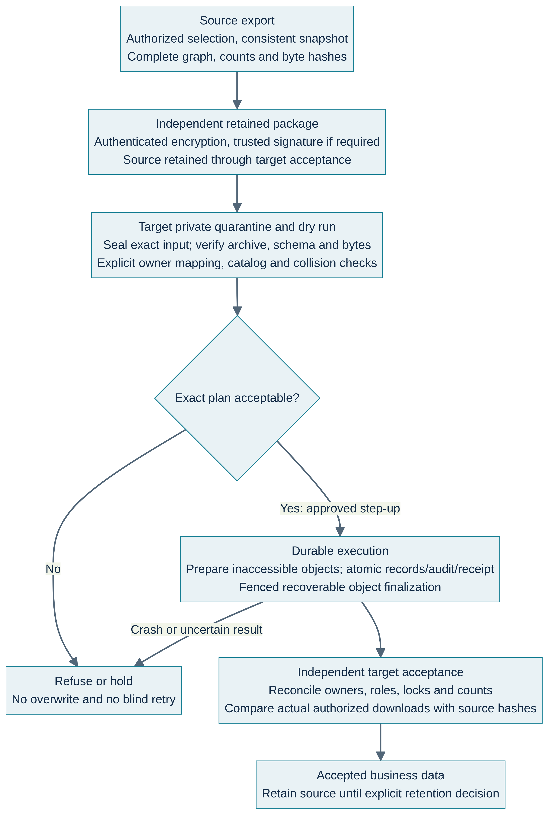
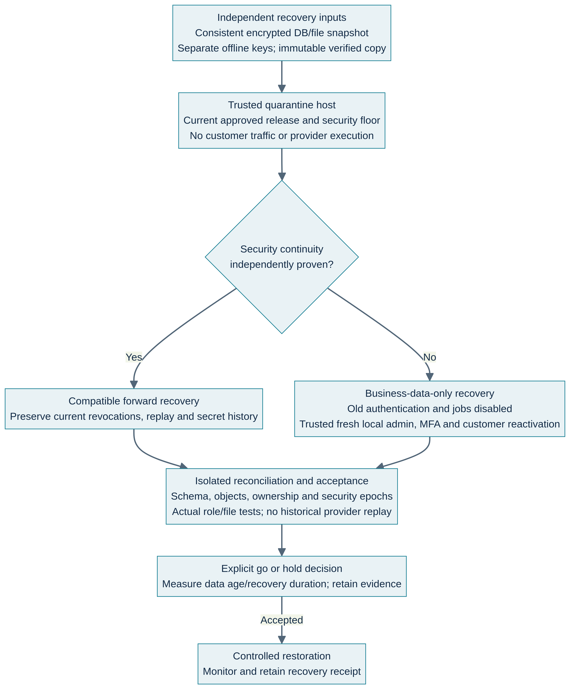
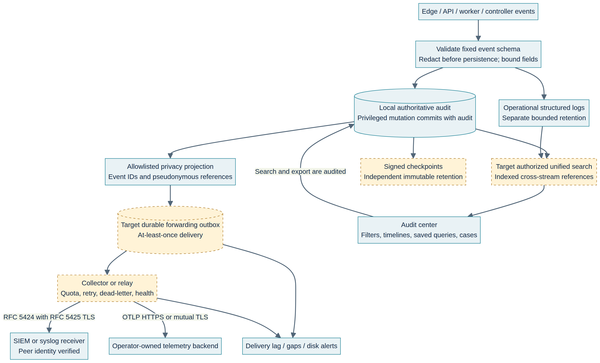
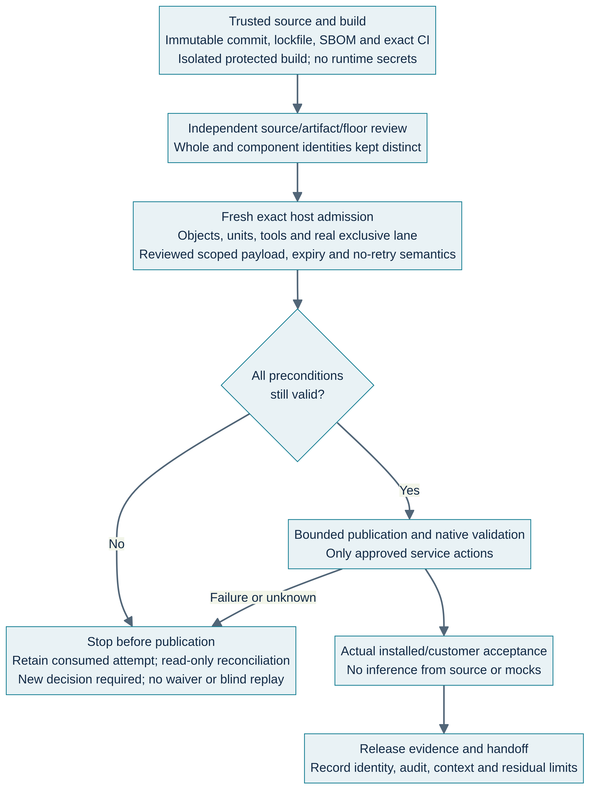

**Version:** 2026-11-20. **Prepared for:** ReadyPackets. **Author:**
Manus AI. **Repository:** readypackets/ReadyPackets-SiteSplit.
**Reviewed source baseline:** 41abac3177e23ce72dcbf8c03a7274d255a5633a,
branch feat/direct-github-factory-launcher-20261118.

This architecture describes the implemented source foundation and the
stronger target needed to recreate ReadyPackets securely, preserve
portable customer/order/file records, recover from corruption, and
operate an advanced correlated audit center. **SOURCE** means inspected
code exists; **TARGET** means a required future implementation or
strengthening; **HOST OBSERVED** means a separately recorded actual
observation. These labels are not interchangeable. Diagrams show the
intended architecture and relationships, not proof of installed
readiness. Proposed examples are illustrative contracts, not existing
API/schema compatibility promises.

The last accepted production observation was **20 November 2026, 04:11
US Eastern**: the fresh HTTP attempt stopped before marker/configuration
publication; original application, MySQL and root/security bindings were
preserved. Installed whole release remained
2c54c2f731f3a45837383a4bafa5c8414a607b21. Public HTTP/HTTPS completion,
missing controllers, renewal infrastructure, and fresh-production
backup/portable acceptance were still outstanding. This documentation
task performs no host operations and grants no third HTTP attempt. Read
the [<u>current installation
status</u>](https://github.com/readypackets/ReadyPackets-SiteSplit/blob/feat/direct-github-factory-launcher-20261118/docs/launch-readiness/2026-11-19/INSTALLATION_CURRENT_STATUS.md)
for the precise operational hold.

# Contents

1.  Platform mandate and surfaces

2.  Topology, stack, and component ownership

3.  Domain model and identity boundaries

4.  Request, authentication, and authorization architecture

5.  Data protection, files, and integration security

6.  Portable business-data contract and execution

7.  Backup, corruption handling, and disaster recovery

8.  Advanced logging, audit center, and SIEM/syslog

9.  Workers, maintenance, installation, and release trust

10. Accessibility, PWA, public discovery, and optional analytics

11. Source findings and prioritized design decisions

12. Verification, operating objectives, and recreation handoff

13. Source anchors and standards

# 1. Platform mandate and surfaces

ReadyPackets is an operator-owned business-services platform. Customers
create named orders/projects, submit intake and protected files,
complete required policies, track workflow phases, receive deliverables,
and communicate with staff. Staff deliver work without exposing
unrelated customer records. Administrators govern customers, orders,
workflows, catalogs, configuration, integrations, security, audit,
backups and portable transfer.

The public marketing site at www.readypackets.com is an independent
deployment. Its **My Portal** link points to
https://my.readypackets.com/; it must not share portal cookies, private
APIs, storage, customer content or credentials. The dedicated portal
serves login and authenticated workflows rather than the complete public
marketing application. Explicit aliases, including
portal.readypackets.com, redirect to one canonical origin; they do not
create parallel authentication origins.

**SOURCE:** React portal/admin/public page sets and server routers cover
substantial order, intake, file/audio, messages, tickets, policies,
invoices, workspaces, catalog/content, CRM, email, integration, security
and recovery functionality. A menu or route is not proof its provider,
privilege, database or recovery path is accepted. Preserve these modules
in a rebuild, but validate the complete journeys rather than reproducing
unused navigation.

**TARGET:** local authentication and MFA remain usable without an
identity provider; all third-party integrations are optional and
deliberately configured. No Manus runtime, OAuth, SDK, platform API,
hosted asset, storage, telemetry or vendor service may become a deployed
dependency. Operator sovereignty includes independently usable code,
schemas, documentation, keys, recovery tools and portable data.

Security is a measured risk-reduction program, not an absolute claim.
Use OWASP ASVS 5.0.0 Level 2 as the baseline verification target and
select higher-assurance requirements for privileged operations, release
trust and recovery. Record exact versioned requirement identifiers in
implementation evidence. “Zero proof” is interpreted here as no inferred
trust and evidence-bound acceptance, not an unsupported promise of
zero-knowledge cryptography. [<u>1</u>](https://asvs.owasp.org/)

# 2. Topology, stack, and component ownership

ARCHITECTURE DIAGRAM

<figure>

<figcaption aria-hidden="true">
Target system topology and private
trust boundaries
</figcaption>
</figure>

*Figure 1. Intended system topology. Dashed amber components identify
major target/Day-2 additions. Even solid components require exact
installed acceptance; the diagram does not establish public HTTPS or
encrypted-backup readiness.*

## 2.1 Current technical foundation

**SOURCE:** package.json specifies React 19, TypeScript, Tailwind CSS 4,
Vite, Express 5, tRPC 11, Zod, Drizzle ORM and MySQL client libraries,
Node.js at least 22, pnpm with a fixed package-manager version, and
Vite/esbuild build outputs. The selected release and lockfile—not
floating version ranges or an old architecture page—determine installed
versions. Choose supported patched versions through a current dependency
review when rebuilding.

The recommended architecture is a modular monolith: feature-oriented
routers call domain services, which call bounded repositories and
adapters. This is easier to govern and recover than introducing
microservices before an actual isolation or capacity need. Separate
browser/API contracts, domain policy, storage, cryptography, audit
emission, providers and privileged controller IPC. Shared TypeScript
types improve developer correctness but never replace server input
validation or authorization.

The single-node native topology uses Nginx as the public edge, a
loopback/private Node API, private MySQL and local protected object
storage. Optional S3-compatible storage enables shared objects across
web replicas. A worker role performs bounded background work. Systemd
supervises native services; application-controlled lifecycle operations
use fixed typed Unix-socket protocols and reviewed root helpers, not
general shell commands.

## 2.2 Component responsibilities

The edge owns canonical-host routing, trustworthy TLS, explicit proxy
identity, body/rate limits, consistent headers and static delivery.
Unknown hosts are rejected. Direct origin deployments must not enable
Cloudflare client-IP header trust merely because the DNS provider is
Cloudflare. Origin CA deployment is a separate deliberate topology; it
is not interchangeable with a browser-trusted direct-origin certificate.

server/app.ts owns HTTP composition. server/trpc/context.ts and trpc.ts
own resolved identity and shared procedure guards. Feature routers and
server/services own business policy. server/db/schema.ts and reviewed
migrations own relational integrity. server/security owns CSRF, headers,
rate limits, IP and cryptography. server/observability owns event
emission and forwarding. deploy and operational scripts own admitted
host actions; React must not become a privilege broker.

**TARGET:** database credentials are separated by application,
migration, backup and operational purpose. Private listeners, encrypted
disks/backups, reviewed file custody and least-privilege identities
constrain lateral movement. Container profiles require non-root users,
read-only images, dropped capabilities, no host Docker socket, separate
secrets and private networks. A Docker application startup is not native
root-controller/backup/uninstall parity; unsupported operations must
fail closed.

## 2.3 Scale and availability

Start with one documented native VPS, then scale only against measured
budgets. Shared database-backed sessions and private object storage are
foundations, not proof of multi-node correctness. Process-local download
tickets, rate-limit budgets, upload capabilities and drain state require
redesign or a proved routing/shared-state strategy before replicas. A
dedicated worker uses fencing and durable claims, not an assumption that
a released named lock terminated old work.

Operational readiness should separately report database connectivity,
storage integrity, disk/inodes, controller reachability, worker lag,
backup age/verification, current key custody, certificate expiry and
release identity. A shallow database readiness endpoint does not prove
the complete system is recoverable. Display unknown and stale evidence
distinctly from healthy.

# 3. Domain model and identity boundaries

ARCHITECTURE DIAGRAM

<figure>

<figcaption aria-hidden="true">
Conceptual business and portable
identity model
</figcaption>
</figure>

*Figure 2. Conceptual relationships, not a literal Drizzle schema.
Stable portable references and historical-extension modules are target
contracts. Authentication material is deliberately outside portable
business data.*

## 3.1 Business records

A customer owns one or more orders. An order requires a project/name,
catalog items, pricing/currency, workflow/status, timestamps, ownership
and applicable lock state. Files belong to an order and customer and
carry a private storage key, declared/detected content type, byte count,
content hash, category/phase, visibility and version metadata. Sharing
is a grant, not ownership; current grant scope and revocation apply to
every read/write/export.

Policies/acceptances, intake, messages, invoices/payment/refund
evidence, custom profile values, file versions/derivatives and
provider/workflow history are linked domains. They must not be inferred
from a payment status or acceptance timestamp. Importing an order
summary does not reconstruct the legal or financial evidence behind it.

Business labels and mutable customer/order references are distinct from
database primary keys and future stable portable identifiers. Changes to
customer/order references preserve retired-reference reservations and
evidence restrictions. Order reassignment is a transactional authority
change with audit and access revocation, not just a client-side owner
dropdown.

## 3.2 Identity data versus portable customer profiles

**SOURCE:** customers have encrypted selected profile fields, HMAC email
indexes, role/status and local/SAML identity metadata. Existing portable
loaders create fresh local customer records and re-encrypt fields under
target keys. They exclude password hashes, MFA material, recovery codes,
sessions, SAML bindings, provider secrets and original storage keys.

**TARGET:** portable identity means a stable business identity reference
and provenance, never an automatically active account. A target customer
requires verified activation/password setup and local MFA. Do not grant
administrator privileges from an archive, link solely by matching email,
or transport authentication material as a convenience. An account
transfer is not proof the same person controls an email on the target.

## 3.3 Database constraints and evolution

Use explicit foreign keys where appropriate, immutable
provenance/mapping records, unique operation/idempotency constraints,
domain-valid timestamps and decimal/minor-unit money, and
owner/order/file consistency checks. Derive critical schema and
migration inventory from the selected source; no historical table count
is an acceptance contract. Review forward-only changes, index costs,
encrypted-field migrations and cross-version adapters. A startup schema
contract blocks incompatible traffic but does not prove existing data is
semantically consistent.

# 4. Request, authentication, and authorization architecture

ARCHITECTURE DIAGRAM

<figure>

<figcaption aria-hidden="true">
Target account-transition and
high-impact step-up gates
</figcaption>
</figure>

*Figure 3. A single authoritative next-action evaluator prevents
onboarding redirect loops while preserving restricted sessions. This is
the target state model, not a claim every current assurance boundary is
consistent.*

## 4.1 Request processing

**TARGET:** validate host and configured proxy boundary; apply cheap
IP/rate/resource controls; install security headers; enforce bounded
parsing; resolve session identity; then enforce unsafe cookie-request
origin/CSRF binding and procedure/resource authorization. Raw signed
webhooks have deliberately narrow independent routes and
signature/replay checks. Neither CORS nor SameSite replaces
authorization or CSRF.

**SOURCE finding:** server/app.ts:createApp mounts csrfMiddleware before
tRPC createContext supplies res.locals.csrfSecret. The cookie/header and
origin protections remain, but the inspected middleware does not
establish the advertised authoritative session-secret comparison at that
point. The rebuild must resolve identity before the unsafe-method check
and add direct HTTP/tRPC tests. This is a static finding, not a newly
reproduced deployed exploit or authorization to repair production.

Strict schemas cap strings, arrays, nested structures, query windows and
uploads. Use parameterized SQL and contextual escaping; reject mass
assignment and unknown sensitive fields. Test tRPC batches under the
strictest included operation's rate/auth policy. Proxy/header spoofing,
oversized bodies and expensive searches must not consume unbounded
application resources.

## 4.2 Password and MFA

**SOURCE:** Argon2id is configured at 64 MiB, three passes, parallelism
one with approved bcrypt migration. TOTP has transactional replay
checks; factor setup is session-bound and timed; recovery codes are
hashed/single-use; enrollment confirmation and recovery-code
acknowledgment are distinct durable steps. Role MFA policy currently
defaults admin-required and staff/customer-optional and is configurable.
Do not describe mandatory MFA for every current role as implemented.

**TARGET:** mandatory local MFA for the rebuild; uniform minimum
15-character passwords, a safe bounded configurable minimum, at least 64
supported characters, consistent Unicode code-point counting, no
truncation, blocked/common/compromised values, password-manager support
and no arbitrary composition/routine-expiry rules. NIST's single-factor
minimum is 15, and its minimum for passwords used only within MFA is
eight; the stronger uniform ReadyPackets profile is a design decision,
not an automatic edit to existing policy. Passwords and TOTP are not
phishing-resistant; prioritize reviewed WebAuthn/passkeys with safe
recovery. [<u>4</u>](https://pages.nist.gov/800-63-4/sp800-63b.html)

Administrative reset modes include email link, generated temporary
password and manually entered temporary password. All share policy
checks, local/SSO restrictions, fresh step-up, force-change behavior and
session revocation. No route returns an existing password. MFA code
copying must not implicitly advance acknowledgment or completion.

## 4.3 Sessions and onboarding transitions

**SOURCE:** signed JWT cookies pair with authoritative user_sessions
rows, account checks, revocation, idle/absolute expiry and rotation.
Pending/restricted flags gate incomplete authentication. Production
cookies are host-only Secure/HttpOnly/SameSite=Strict. Download tickets
are account-bound process-local state, not shared replica/session
authority.

**TARGET:** centrally derive allowed remediation actions from completed
prerequisites and current assurance. A user needing MFA and password
change receives a restricted session that can fulfill them without two
pages redirecting to each other. Complete customer/admin data access
requires all current policy predicates. Fresh step-up for
backup/export/import, identity conversion, privileges, secrets,
retention and lifecycle actions is separate from long-lived login.

## 4.4 Enterprise identity and role scope

**SOURCE:** optional SAML, local/SSO conversions and self-hosted mobile
authorization/PKCE exist. SAML assurance may come from local factor, a
configured Entra claim or both. Broad admin/staff business access
exists; assignment-based staff least privilege is a target decision, not
established source.

**TARGET:** explicit issuer/audience/recipient/time/signature/algorithm
and request/replay validation, durable multi-node replay cache, trusted
certificate rotation, pinned subject binding, no silent email linking,
bounded auto-provisioning roles and verified assurance. Store
authentication method/assurance/time in sessions and consistently
enforce current role policy for browser, API and mobile. Revoking or
raising policy must affect existing sessions.

**SOURCE findings:** SAML logout clears a different cookie name and does
not revoke the authoritative session; normal auth logout does.
Entra-only assurance and local mfaEnabled checks are inconsistent at
admin/mobile boundaries. Database-only admin network entries do not
activate the environment-conditioned deny behavior. Treat these as
required source remediation and negative-test targets; this document
makes no exploit severity or deployed acceptance claim.

## 4.5 Resource authorization

Every list, search, detail, upload, download, share, export, import, job
and admin mutation checks both capability and row scope. Customers
cannot choose another owner's ID or evade an order lock. Staff/admin
access is explicitly governed; global operations visibility must not be
confused with customer ownership. Test older pagination, trash/deleted
records, grants revoked during download, file visibility and locked
imported orders. A React route guard only improves usability.

# 5. Data protection, files, and integration security

## 5.1 Keys and encrypted data

**SOURCE:** selected fields use AES-256-GCM with random IV and record
AAD; email search uses a separate HMAC blind-index key. Not all
tables/files are encrypted by this field mechanism. Legacy plaintext
acceptance exists and needs an explicit migration boundary. Neither
encrypted disks nor object storage encryption should be assumed from
code labels.

**TARGET:** classify data and define coverage explicitly. Use versioned
envelope key IDs, independently controlled keys, resumable dual-read
re-encryption/index transitions, key retirement criteria, crypto-error
handling and recovery compatibility. Never replace the data or
blind-index key casually; that can make records unreadable or login
indexes unusable. Session/token signing rotation and data-key rotation
are different operations.

Configuration validation refuses defaults/weak/missing secrets; optional
providers remain inert without approved complete configuration. Secret
import/export uses strict data grammars and encrypted custody, never
sourced shell assignments or executable snippets. Root helpers must not
inherit unreviewed loader/startup environment overrides.

## 5.2 Private object lifecycle

Upload acceptance binds owner/order/phase/current grants and lock state
before writing. Validate extension, actual content/magic bytes, category
limits, text structure and executable/scriptable rejection. Add malware
quarantine where risk warrants; a file-type library alone is not a
malware scan. Store opaque keys outside the public web root. Serve
protected attachments only after reauthorization, with nosniff and
controlled range/download semantics.

Normalize MIME policy across browser capture, upload, export, verify and
import. WebM may be reported as audio or video depending on inspection;
the same valid object must not export successfully then fail import due
solely to inconsistent classification. Preserve format/structure checks,
byte hashes and size limits. Test WebM, MP4/M4A, Ogg and genuine invalid
payloads.

Use no-follow descriptor-based custody, private staging, exact owned
cleanup and size/inode checks where privileged tools touch paths.
Preserve restrict-SUID/SGID security controls; new directories use
reviewed ordinary service-group access without setgid. Do not repair
portability by recursive chmod/chown or weakening the application
sandbox.

## 5.3 Optional providers

SharePoint/Graph setup provides site URL discovery, site/drive/folder
selection, save/test and approved destinations. New friendly folder
labels use the first two first-name characters, full last name and
customer ID plus safe order names; sanitize Unicode, separators, length
and collisions. Labels are not authorization identities. Existing folder
evidence is not silently renamed, and personal labels must not leak to
logs.

**SOURCE:** legacy and newer leased conversion/transfer pipelines
coexist. Newer jobs carry snapshots, hashes and idempotency metadata;
delegated audio authorization asks for broad provider scopes.
**TARGET:** least-privilege dedicated identities/site grants, pinned
destinations, initiator revalidation at callback, explicit pipeline
boundaries, stale-job reconciliation and provider-byte readback
acceptance. A discovery success does not prove remote upload integrity
or exclusive least privilege.

SMTP/Graph mail, payments, signed phase/workflow webhooks and other
optional providers need dedicated credentials, bounded retries, durable
inbox/outbox and audited configuration. No hardcoded live webhook/API
defaults. Validate egress against SSRF, redirects, rebinding,
metadata/private targets and malicious upload-session URLs, with an
explicit approved private SIEM exception rather than broad bypass.

Provider side effects use stable operation IDs and durable reservations.
Duplicate/out-of-order payment events and concurrent invoice creation
require business constraints and reconciliation, not a generic retry
loop. Exported historical evidence never triggers live provider jobs.

# 6. Portable business-data contract and execution

ARCHITECTURE DIAGRAM

<figure>

<figcaption aria-hidden="true">
Target portable transfer, custody, and
uncertain-outcome handling
</figcaption>
</figure>

*Figure 4. Target end-to-end portability workflow. Consistent snapshots,
complete dry runs, lifetime-sealed inputs, durable finalization and
independent target acceptance are requirements, not existing universal
guarantees.*

## 6.1 What the current format actually carries

**SOURCE:** scripts/portableDataTransfer.ts defines single-record
readypackets.portable-data-transfer.v1 and its envelope;
portableTransferBatch.ts defines bulk v2 and importer compatibility with
both. Files are .rptransfer newline-terminated JSON envelopes using
scrypt and AES-256-GCM, with base64url envelope bytes and base64 file
contents. Current KDF parameters are N=32768, r=8, p=1, derived key 32
bytes; salt is 16 bytes and GCM IV 12 bytes. Decrypted packages identify
format, package ID, source-system pseudonym, generated time, source
release, scope and customer/order/file contents.

V2 captures customer selections and dependent orders/files in a
repeatable-read read-only database transaction. File bytes are
separately retrieved and matched against recorded sizes/hashes; this is
not a true object-store snapshot. Chunk limits are bounded; current
source permits aggregate batches up to 10 GiB encoded output, 1,000
artifacts, 10,000 records per package, hard 192 MiB package and nominal
128 MiB file, with encoding overhead imposing earlier limits. These are
current-source limits, not recommended promises for every deployment.

Portable core coverage includes fixed customer profile fields, core
order/project/pricing/status/timestamps/items/status history, and
eligible active current order files. It excludes
passwords/MFA/sessions/SSO/secrets and many linked records:
invoices/payment/legal evidence, intake, messages, custom profile
values, prior versions, deleted history and provider/workflow/access
evidence. Report omissions explicitly. A transferred payment flag is not
an invoice/payment receipt.

## 6.2 Present controls and important limitations

**SOURCE:** source-to-target mappings are constrained by source
system/type/reference; existing arbitrary email/order collisions fail;
target products must match; mapped orders preserve their owner and do
not silently unlock. Files use target upload validation, fresh storage
keys, verified bytes/hash and mapped ownership. Default imports are
read-only unless explicitly selected editable.

GCM authenticates a shared passphrase, not source organization identity.
There is no independent asymmetric package signature. Current packageId
is produced as a JSON draft hash but validation checks its shape without
recomputing that digest. Export selection checks files.order_id but does
not independently reject mismatched source owner_user_id. Browser
inspection is not a full target dry run: it does not prove
catalog/collision/storage/commit viability, and pending apply is not
bound to the reviewed ciphertext before writes. The root reviewed path
adds ciphertext hash/size admission, but does not establish
organizational provenance.

SQL rows, mappings and audit commit together per package, while objects
are staged before that transaction. Best-effort object rollback is not
crash-proof distributed atomicity. Multi-part batch commits can remain
partial. Segmented upload currently has a 20-minute total limit,
120-second idle limit and bounded per-chunk/finalization limits; do not
apply older 120-second total documentation to it.

Some documentation describes a Python input keeper and more advanced
lifetime/forward-only contracts not present in the reviewed executable
source. They must be treated as separate design/branch requirements, not
already installed controls.

## 6.3 Future-system portability without vendor lock-in

**TARGET:** portability means a future authorized system can
independently decrypt, inspect and map documented business data. It does
not mean arbitrary software automatically accepts ReadyPackets packages.
Publish normative versioned JSON Schemas, dictionaries, enumerations,
migrations, crypto/encoding test vectors, an offline
decrypt/validate/extract tool and a reference importer into a different
data model. The tools must work without the original application
database, hostname, environment or platform keys; package decryption
credentials remain separately necessary.

Use a standard non-executable archive with UTF-8 JSON/JSONL records and
byte objects inside an authenticated encryption envelope. Define
canonical manifest/signature serialization, schema versions and
compatibility policy explicitly. Retain adapters for existing v1/v2. A
draft next-generation contract becomes supported only when
writer/reader/adapters and negative tests pass.

An illustrative next-generation package layout is:

manifest.json

schemas/ versioned schema references or approved snapshots

records/customers.jsonl

records/orders.jsonl

records/order-items.jsonl

records/status-history.jsonl

records/files.jsonl

objects/\<sha256\> actual file bytes, never executable paths

extensions/\<type\>/ optional non-executable evidence

checksums.json

signature.json optional trusted-origin signature metadata

Content-addressed object names do not permit cross-owner deduplication
leakage: authorization and tenant/site scope remain explicit. Archive
manifests bind counts, dependency closure, all parts, objects,
checksums, schema digests and coverage. Check encryption tags before
use; verify file sizes/hashes on extraction and final target download.
Checksums are integrity checks, not provenance signatures. A signing key
included in the same package must not become automatically trusted.

## 6.4 Contract fields and compatibility

A manifest includes contract/package/export IDs, producer
version/release, source-installation reference, generated UTC time,
snapshot identity, supported/minimum reader capabilities, scopes,
required/optional extensions, part index/count and aggregate manifest
digest, entity counts, dependency graph, object inventory, original
timestamps and explicit exclusions. Stable portable references are
distinct from local IDs and mutable business labels. Money uses declared
currency and integer minor units or exact documented decimal encoding;
dates use unambiguous UTC/offset formats.

The importer refuses unsupported required modules, invalid graphs and
ambiguous mappings. Optional unknown evidence may be retained as inert
bounded content with provenance and displayed limitations; it must not
execute or become trusted domain policy. An unknown enum that changes
business semantics cannot be guessed. Compatibility adapters preserve
original fields and record transformation versions; silent data
truncation is not success.

Customer-only, complete-order-with-files, selected-file and all-core
profiles are distinct. Order export includes necessary customer
references; file-only import requires a verified target order/owner.
Multiple/all selectors operate over the full authorized dataset with
pagination/snapshot semantics, not only the current UI page. A schedule
must persist the selection policy and snapshot evidence; dynamic “all”
and a fixed selection mean different things.

## 6.5 Safe operation state machine

The target state machine is received → quarantined → verified → planned
→ approved → objects-prepared → records-committed → finalized →
reconciled → accepted. Each transition has an immutable operation ID,
exact reviewed input/plan digests, target identity, actor/step-up, time,
claim/fencing generation and durable result. Failures are categorized;
uncertain completion becomes held-unknown, not failed-and-retry.

Seal reviewed input ownership from admission through completion.
Reopening a pathname is not byte custody. Verify archive/member safety,
no traversal/absolute paths/links/duplicates/bombs,
expansion/count/resource limits, schema, owner relationships and every
content hash before mutation. Validate target catalog, conflicts,
storage policy, lock choices and exact remapping through a no-write
plan. Approval is consumed only for the exact current package and plan.

Prepare inaccessible objects with a durable staging ledger. Commit
business records, mapping receipts and audit intent/result atomically
where possible. Finalization publishes object visibility under a fenced
job and independently reconciles the database/object boundary. Recovery
deletes only exact owned unreferenced staged objects after durable-state
proof; it cannot infer absence of committed references from a timeout.
Never automatically rollback a partly committed batch or replay unknown
import writes.

## 6.6 Historical evidence and retention

Define future extension modules for invoices/payments/refunds, legal
acceptance, intake/questions/answers, messages, custom profile values,
file versions/derivatives, workflow/integration/file-access evidence and
identifier history. Preserve original attribution, values, dates and
source provenance as history; never replay payments, emails, hooks,
signatures or provider work. Record evidence authenticity and
transformation limitations instead of inventing legal equivalence.

**SOURCE:** schedules are initially paused; secrets/selections use local
encrypted settings; retention removes local artifacts and download
copies under separate deadlines. Local retention does not remove already
downloaded or SharePoint copies. Provider upload metadata checks are not
remote hash verification. Artifact readable-mode publication can precede
retention registration in current source.

**TARGET:** private stage → durable retention/manifest registration →
service-readable publication, independent provider download/hash
verification, immutable recovery copies, legal/operational holds,
separate provider retention and expired-object cleanup evidence. A
schedule or timer must not activate automatically during unrelated
installation. Keep source and independently usable packages until
approved target acceptance and explicit retention/shutdown decisions.

# 7. Backup, corruption handling, and disaster recovery

ARCHITECTURE DIAGRAM

<figure>

<figcaption aria-hidden="true">
Target disaster recovery with
preserved security continuity
</figcaption>
</figure>

*Figure 5. Recover business data without resurrecting old authentication
or replay state. Loss of trusted security continuity requires quarantine
and fresh verified identity bootstrap, not permission to restore
historical credentials.*

## 7.1 Three different operations

A **portable import** appends/reconstructs approved business entities
without transporting identity secrets. A **full restore** replaces an
installation dataset and can include authentication/key/configuration
material. **Forward repair** corrects compatible current state without
undoing security history. Their plans, permissions, validation and
target confirmations must remain distinct.

**SOURCE:** canonical deploy/backup.sh produces manifest format 2 with
database SQL, storage archive, configuration, checksums and
inventory/schema evidence. The configuration includes data/index keys;
an unencrypted archive therefore represents plaintext platform access.
Requested encryption now fails if no configured backend exists, but the
default service invocation is unencrypted. Offsite-copy failure may warn
while the local backup completes. Legacy backup-321.sh uses a different
envelope and warning-only fallback; it is not equivalent recovery
evidence.

Full restore performs destructive matching-key SQL/storage replacement
with best-effort safety rollback, target topology preservation and
migrations/session revocation. Alternate database selection alone does
not isolate file writes. Database-held settings and jobs can revive
providers after startup. Missing checksums/duplicate
members/extraction/SQL provenance/complete inventory require stronger
acceptance than current permissive branches.

## 7.2 Consistency and independently usable copies

**TARGET:** consistent database snapshot plus captured immutable object
inventory/bytes; fence/await all relevant writers or use a proved
snapshot/object-version design. Separate SQL dump, count queries and
object capture under live mutations do not prove a single recovery
point. Record the snapshot boundary and unresolved writers honestly.

Encrypt every disaster-recovery copy by default and fail closed if
encryption or independent-copy verification fails. Keep at least one
independent off-host copy and one immutable/offline recovery copy,
separated from production credentials. Specify encryption
format/recipients, recovery-key location and ownership, rotation/version
history, retention and legal holds. Keys must be independently
recoverable when the original server is gone; storing the sole
decryption key beside the archive defeats this requirement.

Verify copied bytes through independent download and digest, then
decrypt and restore into isolated storage/database on a quarantined
trusted host. Archive structure/gzip validity is not semantic integrity.
Reconcile schema, rows, objects, owner relationships, timestamps,
identity policy and actual authorized file downloads. Measure achieved
data age and elapsed recovery; keep proposed RPO/RTO distinct from
achieved results.

## 7.3 Security-state continuity

Revocations, spent MFA/reset codes, session/refresh families, SSO
bindings, credentials, key history, payment/provider receipts and
anti-replay ledgers cannot be safely rewound by restoring an old
database. Application anti-downgrade floor alone does not stop
historical SQL from undoing those records.

**TARGET:** independently retained trusted security
epochs/high-watermarks and compatible forward-only repair. The recovery
operation must reconcile current continuity before traffic. Code/root
helpers/floors come from a trusted approved release, never blindly from
archived executable files. Stored jobs/settings are quarantined and
external integrations disabled until reviewed.

If continuity cannot be proven after total loss/corruption, restore
business records only into quarantine with old authentication disabled.
Establish a trusted fresh local MFA administrator through approved
identity bootstrap, invalidate historical login/token material and
reactivate customers through verified target onboarding. Reconcile
financial/provider receipts before any external replay. A missing ledger
must not be treated as “nothing was revoked.”

## 7.4 Corruption and failure handling

For database corruption, missing objects, bad ciphertext, unavailable
keys, incompatible schema, tampered backups or failed provider copies:
preserve original evidence, isolate writes, determine valid independent
copies, produce a scoped recovery plan, validate on an isolated target
and accept only after reconciliation. Do not reinstall over partial
security records, reset floors or retry destructive restores until they
happen to pass.

Retention and uninstall are destructive capabilities. Require an exact
owned-resource manifest, dry-run plan, holds, independently recoverable
encrypted export and explicit target confirmation. Do not remove shared
system packages, unrelated buckets, customer-downloaded copies or Beta
because a local export exists. Complete data purge is a separate
evidenced claim.

# 8. Advanced logging, audit center, and SIEM/syslog

ARCHITECTURE DIAGRAM

<figure>

<figcaption aria-hidden="true">
Target durable correlated event
pipeline and secure SIEM forwarding
</figcaption>
</figure>

*Figure 6. Privacy projection occurs before durable forwarding. External
delivery supplements the local authoritative audit; searchable indexes
and collectors are not the sole recovery copy.*

## 8.1 Current implementation and limitations

**SOURCE:** logger.ts emits JSON with time/severity/message and redacted
bounded context. audit.ts writes security, activity and system-alert
streams. Dedicated file/provider/job/delivery tables supply additional
evidence. Security search supports
severity/event/outcome/actor/IP/text/UTC date bounds; activity listing
exposes fewer filters, with separate entity/user timelines. The UI's
“activity replay” is an audit timeline, not a browser session recording.

TLS SIEM forwarding emits a fixed pseudonymous security projection. It
uses server certificate validation and excludes raw IP/user
agent/customer content/free-form metadata. The current queue is bounded
and in memory: restart/capacity loss, enqueue-triggered retry and no
durable delivery ledger remain. The inspected formatter multiplies
facility by 10 rather than 8 and appends apparent structured data after
a nil structured-data field; target interoperability tests must correct
this before claiming RFC 5424 compliance.
[<u>7</u>](https://www.rfc-editor.org/rfc/rfc5424)

Local DB audit metadata/changes/detail bypass logger-level redaction.
Audit failures are swallowed; many callsites are fire-and-forget and
outside business transactions. Export arrays are bounded, not streaming
evidence archives, and include broader sensitive fields than live
forwarding. No full cross-stream indexed correlation, durable spool,
receiver-acknowledged ingestion or configured mTLS/custom-CA workflow
was established.

## 8.2 Canonical event envelope

**TARGET:** a versioned typed schema shared across security, business
activity, admin mutation, systems, files, jobs, providers, portability,
recovery and release events. Align event/observed timestamps,
resource/service/version, trace/span IDs and numeric severity with
OpenTelemetry, while documenting the local schema and syslog mappings.
OpenTelemetry defines six numeric severity ranges from TRACE through
FATAL; syslog numbers run in a different direction and must be
explicitly mapped, not copied blindly.
[<u>2</u>](https://opentelemetry.io/docs/specs/otel/logs/data-model/)
[<u>7</u>](https://www.rfc-editor.org/rfc/rfc5424)

An illustrative synthetic event is:

{

"schema_version": "rp.audit/next-draft",

"event_id": "synthetic-event-001",

"occurred_at": "2026-11-20T09:00:00Z",

"observed_at": "2026-11-20T09:00:00.012Z",

"severity_text": "WARN",

"severity_number": 13,

"category": "portable_transfer",

"event_name": "portable.import.preflight_refused",

"action": "import",

"outcome": "refused",

"reason_code": "TARGET_COLLISION",

"service": "portal",

"installation_ref": "synthetic-install",

"release_ref": "reviewed-source-ref",

"actor_ref": "pseudonymous-actor",

"actor_role": "admin",

"resource_type": "transfer_package",

"resource_ref": "pseudonymous-package",

"request_id": "synthetic-request",

"correlation_id": "synthetic-import-job",

"parent_correlation_id": "synthetic-review",

"trace_id": "00112233445566778899aabbccddeeff",

"span_id": "0011223344556677",

"duration_ms": 42,

"safe_counts": { "customers": 2, "orders": 6 }

}

This is a proposed field contract, not existing OTel wire JSON or
runtime/customer evidence. Permit only schema-defined safe attributes;
cap bytes/depth/counts and use fixed reason/error categories. Event IDs
are immutable; UTC event time and collection time remain distinct.
Trusted server-generated request IDs and long-lived
job/workflow/package/delivery correlation propagate through asynchronous
work. Validate or replace untrusted trace headers; correlation never
establishes authorization.

## 8.3 Event taxonomy and durability policy

Security events cover login success/failure, MFA
enroll/challenge/replay, reset/recovery, session/token/device
revocation, role/SSO conversion, access denials, policy changes and
abuse. Business events cover order
creation/transitions/reassignment/sharing/locks, file
admission/download, invoices and policy evidence. System events cover
worker claims, controller/native calls, storage/DB/queue health,
backups, verification, import/restore, deployment and retention. Record
attempted, completed, refused, canceled, failed and unknown states
truthfully.

High-impact mutations require local durable audit in the same
transaction as state where possible. If the local authoritative record
cannot commit, refuse unauditable privileged writes safely. Remote SIEM
outage must not deny ordinary reads or destroy local evidence. External
effects require durable intent and result/unknown state; a provider
timeout cannot be rewritten as a definite failure. Document where
operational debug records may be sampled/dropped under quota; mandatory
security/audit evidence must not silently disappear.

Redact before storage, transport and display. Never persist secrets,
tokens, MFA material, passwords, private keys, archive credentials, raw
bodies/SQL, unsafe exception messages/getters or customer file contents.
Local investigation may require limited IP/identity under restricted
retention and reviewer permission; external projection is narrower.
Pseudonymization is not automatic anonymization. Validate log inputs and
escape output to prevent log injection, evidence export injection and UI
XSS.
[<u>6</u>](https://cheatsheetseries.owasp.org/cheatsheets/Logging_Cheat_Sheet.html)

## 8.4 Advanced filtering and correlation

Provide one audit/incident center over defined streams with UTC time
ranges, optional local-time display, severity range,
category/event/action/outcome, actor/role, resource type/reference,
request/trace/span/workflow/job/package/delivery IDs, service/release,
reason code and provider. Support bounded AND/OR query groups and
exact/prefix/range operators; no unrestricted SQL, wildcard regex or
arbitrary full-JSON scans.

Stable cursor pagination uses timestamp plus unique event ID. Index
common combinations such as (installation, occurred_at, event_id),
(category, severity, occurred_at), (correlation_id, occurred_at),
(actor_ref, occurred_at) and (resource_type, resource_ref, occurred_at)
after workload profiling. Use partitioning/archival or an operator-owned
search backend only when measured query/retention needs warrant it.
Indexing status displays stream coverage, lag and source freshness.

The UI supports saved searches, correlation pivots, event timelines,
job/package provenance, incident cases/annotations, outcome transitions
and export jobs. Reviewer roles and field permissions constrain data;
customers never access general security/audit logs. Search, saved-query
sharing, annotation and export generate their own audit events. Enforce
bounded date/result/export budgets and protect CSV/CEF/JSONL encoding.
Raw metadata export is not the default SIEM projection.

## 8.5 Secure receiver configuration and delivery

Use RFC 5424 event syntax and RFC 5425 TLS transport with octet-count
framing and default TCP 6514; validate receiver name/certificate chain
and prefer mTLS when supported. Provide protected custom-CA/client-key
custody where needed, rotation/expiry tests and allowlisted destination
configuration. Never fall back to plaintext UDP/TCP or
rejectUnauthorized=false. RFC 5425 protects transport hop by hop; it
does not prove end-to-end original event truth or remote indexing. Use
modern TLS 1.2/1.3 policies rather than copying old cipher examples.
[<u>3</u>](https://www.rfc-editor.org/rfc/rfc5425)

Syslog priority is facility \* 8 + severity. A synthetic local0 warning
is \<132\>. A valid minimal structure with nil structured data is:

\<132\>1 2026-11-20T09:00:00Z synthetic-host readypackets -
portable_refused - event_id=synthetic-event-001 outcome=refused

Custom structured-data names require standards-compatible naming and
escaping; if using enterprise identifiers, obtain/configure the proper
identifier rather than inventing one. Test message fields, framing byte
length, UTF-8 and severity on representative receivers. Optional CEF and
OTLP/HTTPS adapters need separate semantic/privacy tests; a transport
interface must not accept arbitrary executable templates.
[<u>2</u>](https://opentelemetry.io/docs/specs/otel/logs/data-model/)
[<u>7</u>](https://www.rfc-editor.org/rfc/rfc5424)

A durable privacy-projected outbox/spool persists event IDs and
destination versions before sending. A bounded relay/collector retries
independently with exponential backoff/jitter, handles restart, quotas,
dead letters and redrive, and reports queue depth/oldest age/disk
pressure/TLS state/loss counters. Delivery is at least once; receivers
deduplicate by event ID. TCP write completion means transport write
acceptance, not application acknowledgment/indexing. Where protocol
supports ingestion receipts, retain them; otherwise label receipt
unconfirmed and verify via receiver reconciliation.

TLS receiver outage does not erase local audit. Disk full, corrupt
spool, bad certificates, expired client keys, queue saturation,
duplicate messages and restart must all produce safe visible
health/alerts. No infinite retry or silent event loss. Offsite logging
expands the privacy/data-residency boundary and requires approved
projection, retention and reviewer access.

## 8.6 Tamper evidence and retention

Use append-only application permissions, restricted database roles,
versioned event hashes/canonical bytes, signed chain checkpoints and
independent immutable retention. This provides tamper evidence, not
immunity from a compromised root or signing key. Maintain key versions,
checkpoint custody and chain-break monitoring; retain operational logs
separately from mandatory audit and legally held evidence.

Define retention by data category, necessity and applicable obligations,
not an invented universal legal period. Preview/audit pruning; preserve
incident holds; test restoration and search rebuild. Do not delete old
failure alerts simply because the system is currently healthy.
Historical success/failure and current service state are separate
observations.

# 9. Workers, maintenance, installation, and release trust

ARCHITECTURE DIAGRAM

<figure>

<figcaption aria-hidden="true">
Source-bound release and host
admission with fail-closed publication
</figcaption>
</figure>

*Figure 7. Exact evidence and one-attempt authority are required for a
scoped host change. A precondition refusal stops publication; it does
not authorize reinstalls or guard weakening.*

## 9.1 Jobs and maintenance

**SOURCE:** scheduler and newer jobs provide leases/named locks and
process-local joining. A 20-second forced-exit path remains; legacy and
distributed provider work do not have universally proved drain.
**TARGET:** generation/fencing-bound durable claims and a unified
registry of every writer/provider/controller child. Maintenance stops
new admissions, awaits started work and holds if any uncertain task
remains. Timers cleared and HTTP listener closed do not prove ongoing
remote writes ended.

Define attempt exhaustion, cancellation safe points and durable unknown
states. A lost DB lock/connection must not permit stale work to publish
beside a new claimant. Provider idempotency/reconciliation is required
at each external boundary. Backups and deployment depend on actual
drain/snapshot evidence, not comments describing “safe shutdown.”

## 9.2 Root and release authority

**SOURCE:** protected isolated builds, source-bound inventories,
reviewed release approvals, root helpers outside rollback trees,
persistent P0 floor and fresh-install trust bootstrap exist. A fresh
floor records the first reviewed installed release before
migrations/startup, not a completed update/health result. Whole
application release, frontend composite, engine component, helper bytes,
schema and package inventory are distinct identities.

**TARGET:** root-owned helpers enforce fixed command/action protocols,
strict validation, minimal environment, bounded native calls, private
captures, descriptor custody, independent exact review and immutable
authority. Avoid implicit current-directory/PATH/code trust, arbitrary
shell, mutable dependency imports and broad controller capabilities.
Build in an isolated nonprivileged environment without runtime secrets;
promote verified sealed artifacts rather than rebuilding as root.

Full release acceptance preserves exact Portal and full Android/iOS CI
requirements, lockfile/dependency audit, protected build/resource
checks, helper/floor compatibility, genuine host admission and actual
installed/customer acceptance. Documentation-only publication is not app
CI or deployment proof.

## 9.3 HTTP/TLS and volatile metadata lessons

The current controlled completion is paused after two consumed HTTP
attempts. The latest failed at fresh-touched-pins before writes; later
read-only comparison found /run timestamp differences but did not
capture exact refusal-instant values. No exact historical cause is
established.

A target host publisher needs an explicit reviewed object-role model:
stable identity/type/owner/custody for ancestors, mutable content roles
for approved OS logs, and exact protected target identity/bytes. Broad
volatile ancestor timestamps may be unreliable admission signals, but
dropping checks blindly is unsafe. Review which invariants are
meaningful, prove protected directory/descriptor ownership and
intervening-writer boundaries, then separately authorize any new
attempt. This architecture does not supply a timestamp waiver or
executable host payload.

TLS completion requires actual public challenge reachability, one
approved issuance policy, certificate name/trust/key-pair verification,
admitted configuration test and scoped Nginx action, public health and
renewal acceptance. Package installation or nginx --version is not
module-load/TLS proof. Preserve existing permissions and original
settings/root bindings; no package-phase replay or application/MySQL
restart is implied.

## 9.4 Operator tooling

Provide guided pinned fresh install, plan-default
migration/export/import CLI, read-only health/maintenance tools,
configuration export/import, independent package verifier,
backup/verify/recovery runbooks and scoped uninstall preparation.
Secrets use protected files/descriptors, never command arguments or Git.
Every tool has bounded output, machine-readable exit/status, fixed safe
diagnostic categories, strict target checks and unknown-outcome stops.
Unsupported Docker root/lifecycle semantics remain unavailable until
proved.

# 10. Accessibility, PWA, public discovery, and optional analytics

The interface uses approved ReadyPackets brand assets and clear
navigation, accessible contrast, System/Light/Dark modes, reduced
motion, visible status and honest errors. Do not restore removed Packet
8 or an old logo based on stale catalog prose. Product/pricing content
is versioned owner-controlled data. Desktop login uses right-hand
controls and left slideshow; mobile prioritizes the form. Slideshow
copy/assets are bounded and self-hosted, not executable admin snippets.

Target WCAG 2.2 AA over complete processes, including MFA, recovery
codes, imports and audit search. Test keyboard order/focus, background
modal behavior, accessible names/errors/live regions, text zoom/reflow,
contrast, target size and password-manager/paste accessibility.
Representative widths include 320, 360, 390, 768, 1024, 1440 and 1920
CSS pixels with relevant 200%/400% zoom. WCAG conformance and applicable
ADA duties are not established by responsive CSS or automated checks
alone. [<u>5</u>](https://www.w3.org/TR/WCAG22/)

**SOURCE:** the PWA precaches approved static assets and intentionally
uses network-only authenticated navigation/APIs/files. **TARGET:**
preserve logout/account-switch/update safety and old-tab behavior; never
cache customer records/tokens/documents by accident. Offline customer
workspace, push and native parity require separate
threat-model/acceptance work. Native clients remain Day-2 feature
release scope, without waiving existing full CI policy.

SEO/GEO/AEO improvements belong to the public site: semantic/crawlable
useful content, canonical URLs, sitemap, correct robots rules, accurate
structured data and FAQs. Portal private routes use noindex and
authentication; robots directives are not security controls. No private
customer/audit metadata appears in public schemas or sitemaps.

**SOURCE:** current external analytics are narrowly consent-gated;
policy-only PostHog events avoid SDK/replay/DOM observation/persistent
identities, and Clarity is inert in the main SPA. Earlier login-route
analytics documentation is superseded by inspected source. **TARGET:**
deliberate Clarity/PostHog configuration may expand only through a
reviewed route/privacy/CSP contract. Sensitive
auth/security/recovery/customer/file/admin surfaces remain excluded by
default. No arbitrary snippets or live activation in this documentation
task.

# 11. Source findings and prioritized design decisions

The source reviews identify implementation gaps, not a new penetration
test, CVSS ranking, deployed exploit, or automatic remediation
authority. [<u>Identity/logging
review</u>](https://github.com/readypackets/ReadyPackets-SiteSplit/blob/feat/direct-github-factory-launcher-20261118/docs/architecture/2026-11-20/IDENTITY_LOGGING_SOURCE_FINDINGS.md)
and [<u>portable/recovery
review</u>](https://github.com/readypackets/ReadyPackets-SiteSplit/blob/feat/direct-github-factory-launcher-20261118/docs/architecture/2026-11-20/PORTABLE_RECOVERY_SOURCE_FINDINGS.md)
supply exact paths/symbols and limits.

## 11.1 Identity and authorization first

Resolve session-bound CSRF ordering, authoritative SAML logout,
consistent current MFA assurance/policy, database-only admin network
enforcement and explicit SAML request/replay validation. Add adversarial
HTTP/RPC/mobile tests and ensure required policy changes affect stale
sessions. Preserve resource guards and prove multi-role customer/admin
visibility. These are prerequisites for trusting sensitive
recovery/import controls.

## 11.2 Portability and recovery integrity

Recompute/bind package manifest identity; independently validate source
owner/order/file consistency; implement full no-write target planning
and lifetime-reviewed ciphertext custody; document actual v1/v2
scope/exclusions; add durable object/DB crash reconciliation and
complete-part aggregate manifests. Correct publication/retention
ordering and prove independent remote byte readback. Strengthen backup
encryption defaults, complete checksums/member limits and snapshot
semantics. Protect historical security continuity separately from
application floors.

## 11.3 Observability as an operational control

Unify event schemas/privacy validation and indexed correlation; make
high-impact audit transactional; correct syslog
priority/structured-data/escaping; replace in-memory forwarding with
durable bounded outbox and monitor receipt uncertainty. Add fully
authorized cross-stream filter/timeline/export. Never advertise existing
activity filtering as universal advanced search or TLS forwarding as
guaranteed SIEM ingestion.

## 11.4 Decisions to record before implementation

Create ADRs for portable schema/version/crypto and independent reader;
required versus optional historical evidence; identity
activation/mapping; object/DB finalization; keyring/rotation and
recovery continuity; local audit fail-closed scope; retention/legal
holds; SIEM projection/delivery/receiver compatibility; staff
capabilities; supported native/container profiles; and measured
RPO/RTO/capacity targets. Secure defaults can guide reversible source
work, but business/legal/production decisions require the owner.

# 12. Verification, operating objectives, and recreation handoff

## 12.1 Evidence classes

Keep design, source inspection, mocks/unit tests, synthetic database
integration, exact complete CI/protected build, installed host
observation, customer workflow and isolated recovery drills separate.
Record commit/environment/command/pass/fail/skip and limitations. Source
existence does not mean installed/configured, a green build does not
mean account acceptance, and archive creation does not mean restoration.

This document task ran diagram/document generation and artifact checks
only. It did not execute application/security suites, dynamic probes,
portable imports, backups, restores or provider calls. The two
supporting reviewers read public source and did not operate hosts or
customer data.

## 12.2 Required security and functionality tests

Identity tests cover all onboarding prerequisite combinations,
redirects, enrollment acknowledgment, TOTP/recovery replay, magic
link/SSO/password reset assurance, local/SSO conversion, policy changes
and browser/mobile revocation. Authorization tests cover every
role/resource, owner tampering, stale shares, locked orders, pagination,
trash and downloads. HTTP tests cover CSRF order/session binding,
hostile origins/hosts/proxy headers, tRPC batching, rate/resource
limits, SQL/XSS/command injection, SSRF and upload/archive adversarial
inputs.

Portable tests cover multiple/all selections, cross-hostname/key
systems, supported v1/v2 adapters, a different-model reference importer,
corrupt/missing/extra bytes, collisions/replay, unsupported required
extensions, changed plan/input, source inconsistency, chunk boundaries,
MIME formats and every crash before/after staged/committed/finalized
state. Acceptance independently downloads target files, reconciles
hashes/counts and verifies admin visibility/customer isolation/lock
behavior.

Recovery tests use isolated database **and** isolated file/object
targets, providers disabled and protected keys separately supplied.
Exercise unavailable keys, corrupted/tampered archives, missing members,
old schema/security history, independent immutable copies and full
semantic restore. Audit tests exercise redaction, secret-shaped error
strings, malicious metadata, durable-write failures, bounded
queries/export authorization, chain verification, TLS
certificate/name/mTLS failures, framing/UTF-8, receiver
outage/restart/duplicate/queue/disk saturation and receiver
reconciliation.

Lifecycle tests cover complete writer/provider drain, lost
leases/fencing, exact source/helper/floor/composite identity, prewrite
publication refusal, timer admission, uninstallation manifest boundaries
and immutable backup prerequisite. Browser tests cover
responsive/keyboard/screen-reader workflows, consent revocation,
forbidden analytics routes and PWA update/logout/no-private-cache.

## 12.3 Objectives and operations

Suggested planning objectives—not achieved evidence—are RPO no greater
than one hour and RTO no greater than four hours for core business
recovery, with stronger targets chosen if customer obligations require
them. These require incremental/snapshot architecture, independent keys
and measured drills; a nightly dump cannot satisfy one-hour RPO by
itself. Capacity and p95 latency targets must specify record/file sizes,
concurrency, node resources, providers and measurement windows before
becoming service commitments.

Monitor audit gaps, backup freshness/verification, failed copies,
queue/worker lag, disk/inodes, TLS expiry, controller status, key
custody and dangerous unknown outcomes. Assign
incident/recovery/privacy/accessibility owners. Recovery playbooks
include stop/preserve/isolate/plan/reconcile/accept and escalation; they
never ask users to send passwords, MFA codes, raw archives or secrets
through support.

## 12.4 Rebuild deliverables and acceptance

Use the separate [<u>secure rebuild master
prompt</u>](https://github.com/readypackets/ReadyPackets-SiteSplit/blob/feat/direct-github-factory-launcher-20261118/docs/architecture/2026-11-20/READYPACKETS_SECURE_REBUILD_MASTER_PROMPT.md)
for implementation. Deliver code/lockfiles,
schemas/migrations/contracts, API docs, independent portable
readers/adapters/reference importer, recovery CLI/runbooks, deployment
profiles, threat models/ADRs, SBOM/provenance, current evidence and
operator/customer guides. Work in foundation → core orders/files →
portability/recovery → durable logging → integrations → lifecycle →
complete acceptance order.

Go-live requires actual canonical HTTPS, local onboarding/MFA,
owner/role/file correctness, required controllers, independently
recoverable encrypted backups, accepted portable multi-record roundtrip,
operational audit/search/forwarding posture, and no unresolved reachable
Critical/High issues in enabled capabilities. Optional integrations may
be visibly disabled. Native feature release is separate. No
certification, absolute security or arbitrary future-system
compatibility is promised; the architecture maximizes practical security
and independent recoverability through explicit contracts and
verification.

# 13. Source anchors and standards

Source anchors at the reviewed commit include package.json,
server/app.ts, server/trpc/{context,trpc}.ts,
server/auth/{session,mfa,mfaPolicy,saml,samlMfaSource,mobileOidc}.ts,
server/security/{crypto,csrf,headers,rateLimit}.ts, server/db/schema.ts,
server/services/{orders,orderSharingPermissions,storage,sharepoint,conversionPipeline,portableTransferJobs,portableTransferSharepoint,scheduler}.ts,
server/observability/{logger,audit,siem}.ts,
server/routers/{adminSecurity,siemExport,portableTransfer}.ts,
server/http/{backupRestore,portableTransferUpload,downloads}.ts,
scripts/{portableDataTransfer,portableTransferBatch,portableOperatorAdmission}.ts,
and
deploy/{backup.sh,restore.sh,p0-recovery-config.mjs,backup-control-daemon.mjs,platform-root-safety.sh,platform-release-approval.mjs,isolated-build.sh,build-artifact.py}.

Dated installation status takes precedence over README/August/September
deployment claims. Supporting source reviews describe findings and
omitted tests. Seven editable Mermaid diagrams are included beside their
PNG renderings; no proprietary diagram editor is required.

Authoritative standards were fetched20 November2026. They guide design,
not application compliance certification.

\[1\] OWASP Application Security Verification Standard 5.0.0 —
[<u>https://asvs.owasp.org/</u>](https://asvs.owasp.org/)

\[2\] OpenTelemetry Logs Data Model —
[<u>https://opentelemetry.io/docs/specs/otel/logs/data-model/</u>](https://opentelemetry.io/docs/specs/otel/logs/data-model/)

\[3\] RFC 5425 TLS Transport Mapping for Syslog —
[<u>https://www.rfc-editor.org/rfc/rfc5425</u>](https://www.rfc-editor.org/rfc/rfc5425)

\[4\] NIST SP 800-63B-4 Authentication and Authenticator Management —
[<u>https://pages.nist.gov/800-63-4/sp800-63b.html</u>](https://pages.nist.gov/800-63-4/sp800-63b.html)

\[5\] W3C Web Content Accessibility Guidelines 2.2 —
[<u>https://www.w3.org/TR/WCAG22/</u>](https://www.w3.org/TR/WCAG22/)

\[6\] OWASP Logging Cheat Sheet —
[<u>https://cheatsheetseries.owasp.org/cheatsheets/Logging_Cheat_Sheet.html</u>](https://cheatsheetseries.owasp.org/cheatsheets/Logging_Cheat_Sheet.html)

\[7\] RFC 5424 The Syslog Protocol —
[<u>https://www.rfc-editor.org/rfc/rfc5424</u>](https://www.rfc-editor.org/rfc/rfc5424)
